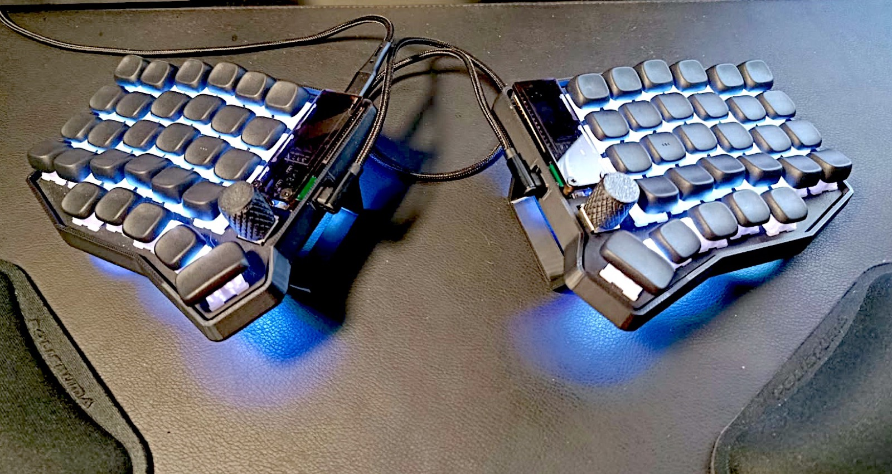
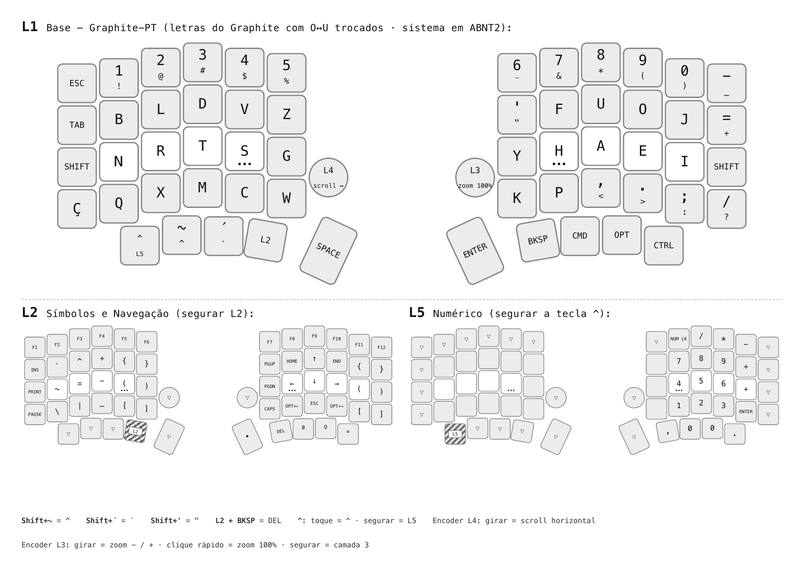

# Graphite-PT para o Tergo Sofle

Keymap para o [Tergo Sofle](https://tecladoergonomico.com.br/loja/tergo-sofle/) (um Sofle v2 com fio, firmware Vial, versão ABNT2) construído sobre o layout de letras [Graphite](https://github.com/rdavison/graphite-layout) e adaptado ao português do Brasil. O sistema operacional continua na fonte de entrada **Português (Brasil) ABNT2**; todo o remapeamento vive no teclado.



## O layout

```
ESC   1   2   3   4   5                 6   7   8   9   0   -_
TAB   B   L   D   V   Z                 '   F   U   O   J   =+
SHFT  N   R   T   S   G                 Y   H   A   E   I   SHFT
Ç     Q   X   M   C   W   [L4]   [L3]   K   P   ,   .   ;   /
          ^/L5  ~   ´   L2  SPC   ENT  BKSP CMD OPT CTRL
```



As letras são o Graphite com duas trocas, medidas num corpus de português do Brasil:

- **O e U trocados.** Elimina os dois bigramas de mesmo dedo dominantes do português no Graphite, `ao` e `eu`. Os bigramas de mesmo dedo caem de 2,37% para 1,40% (o inglês fica em 1,08%).
- **V e W trocados.** O V é 1,2% das letras do português e estava na tecla interna de baixo, o alcance mais difícil de um teclado de colunas retas; o W (0,06%) ocupa essa tecla no lugar dele.

O resto decorre da fonte de entrada ABNT2: `Ç` é uma tecla de verdade, `´` e `~` são as teclas mortas do ABNT2 e ficam no **polegar esquerdo** (2,6 acentos por 100 letras, e todas as vogais estão na mão direita, então acento + vogal alterna as mãos). `Shift+~` dá `^`, `Shift+´` dá `` ` ``.

### Camadas

| Camada | Acesso | Conteúdo |
|---|---|---|
| 0 Base | | letras acima |
| 3 Símbolos e navegação ("L2") | segurar o polegar esquerdo 4 | F1 a F12, `` ` ^ + { } ``, `~ = - ( )`, `\ \| _ [ ]` à esquerda; setas, Home, End, PgUp, PgDn, Caps Word, Opt+setas, Esc à direita; `{ } ( ) [ ]` espelhados nas colunas externas da direita; `Del` no polegar do Backspace; `•`, `ª`, `º`, `°` nos outros polegares direitos |
| 6 Numérico ("L5") | segurar o polegar esquerdo 1 | teclado numérico na mão direita, `,` no polegar do Backspace |
| 4 Ajustes ("L3") | segurar o encoder direito | RGB, escolha da camada padrão, NKRO |
| 5 Mídia ("L4") | apertar o encoder esquerdo | volume, play, anterior, próxima |

O polegar esquerdo 1 é um tap dance: toque dá `^` (morto), segurar ativa a camada numérica. O encoder direito também: toque manda `Cmd+0` (zoom 100%), segurar ativa a camada de ajustes. Encoders: o esquerdo gira scroll horizontal, o direito gira zoom (`Cmd+-` / `Cmd+=`).

Os números das camadas seguem o firmware de fábrica da Tergo (0 Basic, 1 Adept, 2 Custom, 3 Símbolos, 4 Ajustes, 5 Mídia, 6 Numérico, 7 Mouse). A camada 1 ficou vazia de propósito: home-row mods só fazem sentido depois que as letras estão automáticas. A camada 7 não tem tecla de acesso.

### Por que não Colemak nem BR Nativo

Nove layouts foram pontuados num corpus de português com 1,1 milhão de letras (Wikipédia) e num de inglês com 570 mil, simulando um teclado dividido de colunas retas. Uso da home row, carga nos mindinhos, alternância de mãos, bigramas no mesmo dedo (SFB) e esticadas laterais do indicador (LSB), em português:

| Layout | home | mindinhos | alternância | SFB | LSB |
|---|---|---|---|---|---|
| QWERTY ABNT2 | 34% | 18% | 52% | 8,9% | 4,5% |
| Colemak ABNT2 | 75% | 26% | 59% | 2,1% | 0,4% |
| Colemak-DH | 74% | 26% | 59% | 2,1% | 3,2% |
| BR Nativo | 78% | 16% | 77% | 3,1% | 0,9% |
| Gallium v2 | 63% | 15% | 75% | 2,4% | 2,5% |
| Graphite | 60% | 15% | 76% | 2,4% | 0,05% |
| **Graphite-PT** | 61% | 16% | 75% | **1,4%** | 0,04% |

O Colemak põe A e O nos mindinhos (26% de carga em português). O BR Nativo é bom em português mas fraco em inglês (4% de SFB). Os dois também são drivers de sistema operacional, de que um teclado programável não precisa.

A pontuação também foi medida. A vírgula sob o A custa um bigrama de mesmo dedo `a,` (0,3%); ficou lá mesmo assim pela ordem familiar `, . ; /`.

## Instalação

Requisitos: Tergo Sofle com fio com o firmware Vial de fábrica (versão ABNT2), o [Vial](https://get.vial.today/) e a fonte de entrada **Português (Brasil) ABNT2** no computador (testado no macOS; as teclas de polegar `•ªº°` usam combinações com Option do macOS e saem diferentes no Windows e no Linux).

1. No Vial, salve o layout atual antes (File, Save current layout). Carregar um `.vil` substitui todas as camadas, encoders, tap dances e macros.
2. File, Load saved layout, escolha `keymap/tergo-sofle-graphite-pt.vil`.
3. Imprima `cheatsheet/cheatsheet.pdf` (A4 paisagem). `cheatsheet-combined.pdf` é uma versão de camada única com as legendas de L2 e L5 nos cantos de cada tecla, feita para impressora preto e branco.

O arquivo carrega o UID do Tergo Sofle rev0. Em qualquer outro Sofle com Vial, carregue mesmo assim quando o Vial perguntar: a matriz é a mesma, 10 x 6, e só os detalhes de encoder e tap dance podem precisar de ajuste.

## Regenerar

Tudo é gerado a partir de `scripts/`, em Python 3 sem pacotes de terceiros. Os arquivos de referência (o `info.json` da Tergo, a geometria do Sofle no QMK, a tabela de keycodes do Vial) são baixados uma vez para `cache/`.

```sh
python3 scripts/gen_vil.py        # escreve keymap/tergo-sofle-graphite-pt.vil
python3 scripts/normalize.py      # normaliza os nomes de keycode, valida contra o Vial, imprime as camadas
sh scripts/build_cheatsheets.sh   # colas em HTML, PDF e PNG (precisa de Chrome e poppler)
```

Pontuação de layouts: `python3 scripts/analyze.py corpus/pt.txt corpus/en.txt` (arquivos de texto puro; os usados aqui foram extratos de artigos da Wikipédia). `sfb.py` lista os piores bigramas, `punct.py` compara posições de pontuação, `tune.py` é um otimizador guloso de trocas simples. `dump_layout.swift` imprime o que cada tecla e combinação de modificadores produz num layout de teclado do macOS, que foi como as combinações com Option foram encontradas.

## Créditos

- [Graphite](https://github.com/rdavison/graphite-layout), de rdavison.
- [Tergo Teclados](https://github.com/TergoTeclados), pelo Sofle e pelo [firmware Vial](https://github.com/TergoTeclados/vial-qmk-firmware).
- [Vial](https://get.vial.today/).
- Keycaps [KLP Lamé](https://github.com/braindefender/KLP-Lame-Keycaps), de braindefender.

## Summary in English

A keymap for the Tergo Sofle (wired, Vial, ABNT2 edition) built on the Graphite letter layout and adapted for Brazilian Portuguese: O and U swapped (removes the `ao` and `eu` same-finger bigrams), V and W swapped (moves V off the inner bottom key), `Ç` on the left outer column, acute and tilde dead keys on the left thumbs. The OS stays on the Portuguese (Brazil) ABNT2 input source; the whole remap lives in the firmware. To install: save your current layout in Vial, load `keymap/tergo-sofle-graphite-pt.vil` and print `cheatsheet/cheatsheet.pdf`. Details, measurements and generators above, in Portuguese.
